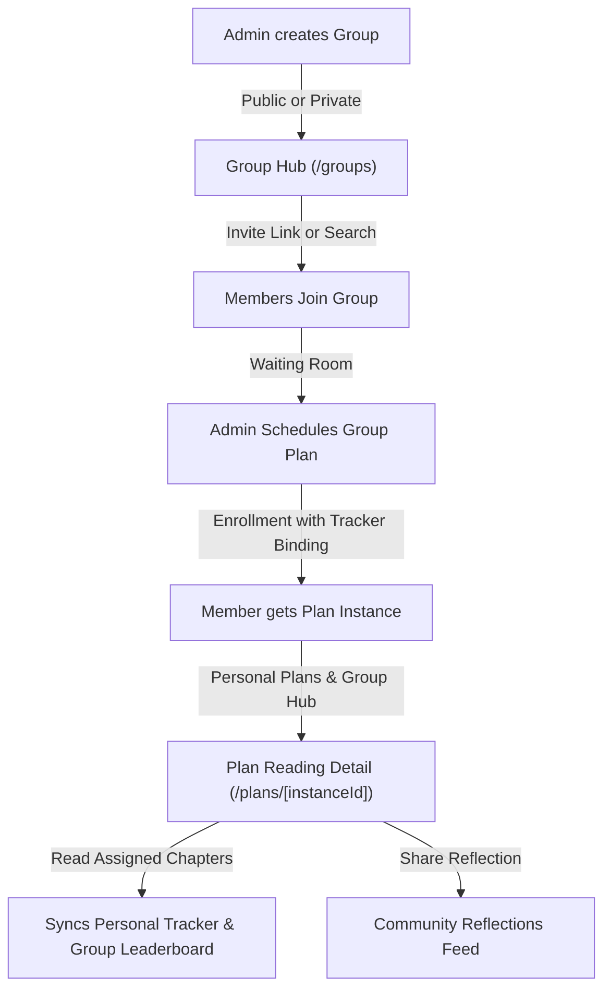
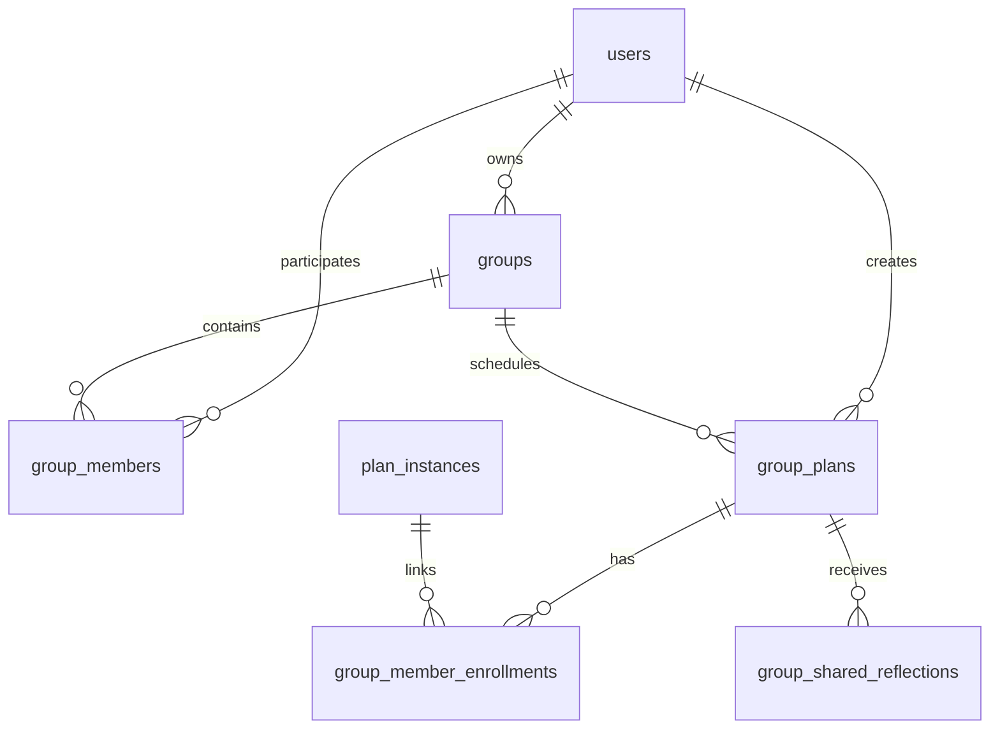

# Community & Cohort Reading: Specification & Implementation Roadmap

> **Status:** Approved for Implementation  
> **Source Alignment:** Aligned via `/grill-me` architectural review  
> **Target Version:** Week 4 Deliverables (Fellowship, Cohort Reading & Admin Suite)

---

## 1. Product Vision & Core Workflow

The **Community & Cohort Reading** system turns solitary Bible reading into a collaborative, habit-forming group experience. Churches, small groups, campus fellowships, and friends can read identical schedules, compare real-time progress on a group leaderboard, and discuss daily scripture sessions together.

### The End-to-End User Journey:


---

## 2. Key Design Decisions (from `/grill-me`)

| Decision Area | Specification | Rationale & Mechanics |
| :--- | :--- | :--- |
| **Discovery & Access** | Public (Searchable) OR Private (Invite link only) | Public groups appear in the `/groups` explorer. Private groups require `https://luma.app/groups/join/[code]`. |
| **Join Approval Gate** | Configurable per group: `requires_approval` (true/false) | Admins can allow instant join or route applicants to an Admin Approval Queue. |
| **Roles & Permissions** | 1 Owner, Multiple Admins, Members | **Owner**: Full control, can delete group, transfer ownership. <br>**Admins**: Schedule plans, manage members, approve requests. Cannot delete group. <br>**Members**: Read, enroll, post reflections. |
| **Multi-Plan Concurrency** | Groups can run multiple active plans simultaneously | Groups can host both a core study (e.g. NT in 90 Days) and a devotional (e.g. Proverbs) at the same time. |
| **Late-Join Policy** | Configurable by Admin per plan: <br>1. `strict_locked`<br>2. `skip_ahead`<br>3. `backfill` | • `strict_locked`: Enrollment closed after start date.<br>• `skip_ahead`: Member starts on today's current reading (omits past chapters from instance).<br>• `backfill`: Member gets full plan from Day 1 and starts in "behind" status with catch-up warnings. |
| **Tracker Binding** | User chooses personal tracker on plan enrollment | Prompt user when enrolling in each plan (with their active tracker pre-selected). Ensures their canon and matrix are respected. |
| **Leaderboard Privacy** | Member toggle: "Hide my progress from leaderboard" | Anonymizes user on cohort leaderboard for readers who desire privacy while reading together. |
| **Session Reflections** | Private by default with explicit "Share with Community" | In the session view, reflections are private by default; clicking "Share with [Group]" posts it to the community reflections feed. |
| **Group Hub Navigation** | 3 Tabs for Admins, 2 Tabs for regular Members | • **Tab 1: Group Plans** (All members)<br>• **Tab 2: Members** (All members)<br>• **Tab 3: Admin Settings** (Owner & Admins only) |

---

## 3. Existing Codebase Audit & Reusability Matrix

We reviewed the current codebase to avoid duplicated work and maximize architectural reuse:

| Subsystem | Existing Asset in Codebase | How Community Feature Will Reuse It |
| :--- | :--- | :--- |
| **Authentication & Sessions** | `src/lib/auth.ts`, `src/lib/auth-client.ts`, Better-Auth session cookies | Verify session and user ID for all server actions and group page loads. |
| **Trackers & Multi-Canon** | `reading_trackers`, `src/actions/trackers.ts`, `src/components/trackers/tracker-switcher.tsx` | Use tracker switcher primitive when prompting users to bind their personal tracker during plan enrollment. |
| **Plan Templates Catalog** | `plan_templates`, `plan_sections`, `src/actions/plans.ts` (`resolvePlanBlueprint`) | Admin plan scheduler directly selects from existing curated & custom plan templates. |
| **Plan Instance Engine** | `src/actions/plans.ts` (`startPlanAction`), `plan_instances`, `plan_instance_readings` | `enrollInGroupPlanAction` will directly invoke `startPlanAction` logic, linking the resulting instance to `group_plans`. |
| **Plan Pacing & Calendar** | `activeWeekdaysMask`, rest-day schedule generator, catch-up rebalancer | Group plans use the existing 7-character bitmask (`1111111`) and daily target pacing. |
| **Reading Detail UI** | `src/components/plans/plan-detail-view.tsx`, `recharts-plan-gauge.tsx` | Enhanced with top Community Header Badge, session community reflections feed, and share button. |
| **Chapter Reading & Reader** | `src/components/bible/bible-reader-core.tsx`, `/bible/[bookId]/[chapter]` | One-click reading links and chapter completion in group plans reuse existing scripture reader routes. |
| **App Navigation** | `src/components/navigation/app-shell.tsx` | Add "Groups" (`/groups` with `Users` icon) directly to `MENU_ITEMS`. |
| **Design Tokens & Theme** | `src/theme/`, HSL tokens (`bg-surface`, `bg-surface-elevated`, `border-border`) | Strict UI consistency across all new group cards, tables, and modals. |

---

## 4. PostgreSQL Database Schema (Drizzle ORM)

### New Enums & Tables to add to `src/db/schema.ts`:



```sql
-- 1. Group Roles & Status Enums
CREATE TYPE group_role AS ENUM ('owner', 'admin', 'member');
CREATE TYPE group_plan_status AS ENUM ('scheduled', 'active', 'completed', 'cancelled');
CREATE TYPE group_late_join_policy AS ENUM ('strict_locked', 'skip_ahead', 'backfill');
CREATE TYPE group_membership_status AS ENUM ('active', 'pending_approval');

-- 2. Groups Table
CREATE TABLE groups (
    id TEXT PRIMARY KEY DEFAULT gen_random_uuid(),
    name VARCHAR(150) NOT NULL,
    description TEXT,
    avatar_url TEXT,
    invite_code VARCHAR(32) UNIQUE NOT NULL, -- e.g. 'luma-grace-8a2f'
    owner_id TEXT NOT NULL REFERENCES "user"(id) ON DELETE RESTRICT,
    is_private BOOLEAN NOT NULL DEFAULT TRUE,
    requires_approval BOOLEAN NOT NULL DEFAULT FALSE,
    created_at TIMESTAMPTZ NOT NULL DEFAULT NOW(),
    updated_at TIMESTAMPTZ NOT NULL DEFAULT NOW()
);

-- 3. Group Members Table
CREATE TABLE group_members (
    id TEXT PRIMARY KEY DEFAULT gen_random_uuid(),
    group_id TEXT NOT NULL REFERENCES groups(id) ON DELETE CASCADE,
    user_id TEXT NOT NULL REFERENCES "user"(id) ON DELETE CASCADE,
    role group_role NOT NULL DEFAULT 'member',
    status group_membership_status NOT NULL DEFAULT 'active',
    hide_progress BOOLEAN NOT NULL DEFAULT FALSE,
    joined_at TIMESTAMPTZ NOT NULL DEFAULT NOW(),
    updated_at TIMESTAMPTZ NOT NULL DEFAULT NOW(),
    CONSTRAINT uq_group_member UNIQUE (group_id, user_id)
);

-- 4. Group Reading Plans Table
CREATE TABLE group_plans (
    id TEXT PRIMARY KEY DEFAULT gen_random_uuid(),
    group_id TEXT NOT NULL REFERENCES groups(id) ON DELETE CASCADE,
    plan_template_id TEXT NOT NULL REFERENCES plan_templates(id) ON DELETE RESTRICT,
    scheduled_start_date TIMESTAMPTZ NOT NULL,
    status group_plan_status NOT NULL DEFAULT 'scheduled',
    late_join_policy group_late_join_policy NOT NULL DEFAULT 'skip_ahead',
    daily_chapter_target INT NOT NULL DEFAULT 3,
    active_weekdays_mask VARCHAR(7) NOT NULL DEFAULT '1111111',
    created_by TEXT NOT NULL REFERENCES "user"(id) ON DELETE RESTRICT,
    activated_at TIMESTAMPTZ,
    completed_at TIMESTAMPTZ,
    created_at TIMESTAMPTZ NOT NULL DEFAULT NOW(),
    updated_at TIMESTAMPTZ NOT NULL DEFAULT NOW()
);

-- 5. Group Member Plan Enrollments Table
CREATE TABLE group_member_enrollments (
    id TEXT PRIMARY KEY DEFAULT gen_random_uuid(),
    group_plan_id TEXT NOT NULL REFERENCES group_plans(id) ON DELETE CASCADE,
    user_id TEXT NOT NULL REFERENCES "user"(id) ON DELETE CASCADE,
    plan_instance_id TEXT NOT NULL REFERENCES plan_instances(id) ON DELETE CASCADE,
    enrolled_at TIMESTAMPTZ NOT NULL DEFAULT NOW(),
    CONSTRAINT uq_group_plan_user UNIQUE (group_plan_id, user_id)
);

-- 6. Group Shared Reflections Table
CREATE TABLE group_shared_reflections (
    id TEXT PRIMARY KEY DEFAULT gen_random_uuid(),
    group_plan_id TEXT NOT NULL REFERENCES group_plans(id) ON DELETE CASCADE,
    user_id TEXT NOT NULL REFERENCES "user"(id) ON DELETE CASCADE,
    session_index INT NOT NULL,
    session_title TEXT,
    content TEXT NOT NULL,
    created_at TIMESTAMPTZ NOT NULL DEFAULT NOW(),
    updated_at TIMESTAMPTZ NOT NULL DEFAULT NOW()
);
```

---

## 5. Server Actions Specification (`src/actions/groups.ts`)

All functions follow the project's named object parameters standard (`export async function createGroupAction({ name, description, ... }: CreateGroupParams)`).

### Group Management
- `createGroupAction({ name, description, avatarUrl, isPrivate, requiresApproval })`
  - Generates slugified invite code (e.g. `fellowship-9k21`).
  - Creates group and assigns creator as `role: 'owner'`.
- `getGroupDetailsAction({ groupId })`
  - Returns group metadata, membership role for current user, active/upcoming plans, and member count.
- `getUserGroupsAction()`
  - Returns all groups current user belongs to with active plans summary.
- `searchPublicGroupsAction({ query, limit })`
  - Returns public groups matching query for discovery.
- `updateGroupSettingsAction({ groupId, name, description, avatarUrl, isPrivate, requiresApproval })`
  - Owner & Admins only.
- `deleteGroupAction({ groupId })`
  - Strictly Owner only. Requires validation.
- `regenerateInviteCodeAction({ groupId })`
  - Owner & Admins only.

### Membership & Approvals
- `joinGroupAction({ inviteCode })`
  - If group `requires_approval = true`, joins as `status: 'pending_approval'`.
  - If `requires_approval = false`, joins as `status: 'active'`.
- `approveMemberAction({ groupId, targetUserId })`
  - Owner & Admins only.
- `rejectMemberAction({ groupId, targetUserId })`
  - Owner & Admins only.
- `updateMemberRoleAction({ groupId, targetUserId, newRole })`
  - Owner & Admins only. Cannot alter Owner.
- `removeMemberAction({ groupId, targetUserId })`
  - Owner & Admins only.
- `toggleLeaderboardPrivacyAction({ groupId, hideProgress })`
  - User can toggle their own leaderboard visibility.

### Plans & Enrollment
- `scheduleGroupPlanAction({ groupId, planTemplateId, scheduledStartDate, dailyTarget, activeWeekdaysMask, lateJoinPolicy })`
  - Owner & Admins only. Creates plan in `'scheduled'` or `'active'` status.
- `enrollInGroupPlanAction({ groupPlanId, trackerId })`
  - Instantiates member's `plan_instances` adhering to `lateJoinPolicy`.
  - Links instance to `group_member_enrollments`.
- `getGroupLeaderboardAction({ groupPlanId })`
  - Calculates completion percentage and "Read Today" status for all enrolled members (respecting `hide_progress`).

### Reflections & Discussions
- `shareGroupReflectionAction({ groupPlanId, sessionIndex, sessionTitle, content })`
  - Posts reflection visible to cohort peers on that session.
- `getGroupSessionReflectionsAction({ groupPlanId, sessionIndex })`
  - Retrieves reflections from peers for the specified session.

---

## 6. UI & View Specifications

### 6.1 Group Hub (`/groups`)
- **Header**: "Community Groups" with search bar and "Create Group" button.
- **Tab 1: My Groups**: Cards displaying group name, avatar, member count, active plans badge, and role badge (Owner / Admin / Member).
- **Tab 2: Explore Public Groups**: Discoverable public fellowships with "Join Group" action.
- **Tab 3: Join via Code**: Single input field for invite code / link with instant preview and join trigger.
- **Create Group Modal**: Dialog with inputs for Name, Description, Avatar URL, Private/Public radio, and Require Approval toggle.

### 6.2 Invite Landing Page (`/groups/join/[code]`)
- Preview card showing group avatar, name, description, member count, and active plan preview.
- "Join Fellowship" button. Handles pending approval feedback if enabled.

### 6.3 Group Detail Hub (`/groups/[id]`)
- **Header Banner**: Group Avatar, Title, Description, Privacy badge, Member count, and Tab navigation.
- **Tab 1: Group Plans (Visible to All Members)**:
  - *Active Plans Card*: Plan title, current day progress, days remaining.
    - If user is enrolled: "Continue Reading" button (links to `/plans/[instanceId]`).
    - If user not enrolled: "Enroll in Plan" button (opens Tracker selection modal).
  - *Upcoming Plans*: Countdown badge ("Starts in 4 days") + "Pre-enroll" action.
  - *Cohort Leaderboard*: Real-time roster of enrolled members, completion bars, "Read Today" indicators, and "Hide my progress" toggle.
- **Tab 2: Members (Visible to All Members)**:
  - Searchable member grid with avatars, names, join dates, and role badges.
- **Tab 3: Admin Settings (Strictly Owner & Admins Only)**:
  - `<PlanSchedulerSection>`: Modal to schedule plans, set dates, weekdays mask, and late-join policy.
  - `<PendingApprovalsSection>`: Table of pending join requests with 1-click Approve / Reject.
  - `<MemberManagementSection>`: Roster with Promote to Admin / Demote / Remove actions.
  - `<InviteLinksSection>`: Copyable invite link, regenerate code, and QR Code display.
  - `<GroupProfileSection>`: Edit details and Danger Zone (Delete Group - Owner only).

### 6.4 Community-Enhanced Plan Detail (`/plans/[instanceId]`)
- **Community Header Badge**: Displays `Community: [Group Name]` with icon, linking back to `/groups/[id]`.
- **Session Reflection Card**:
  - Existing private reflection textarea.
  - New action: *"Share with [Group Name]"* button.
- **Community Reflections Feed**:
  - Tab/Feed on active session: *"Reflections from [Group Name] (3)"*.
  - Displays avatar, name, and notes posted by cohort members for this specific session.

---

## 7. Phased Implementation Roadmap

- [ ] **Phase 1: Database Migration**: Add tables & enums to `src/db/schema.ts`, run `bun run db:push`.
- [ ] **Phase 2: Server Actions**: Implement `src/actions/groups.ts` and Valibot schemas in `src/lib/schemas/groups.ts`.
- [ ] **Phase 3: Shell & Discovery**: Add "Groups" to `app-shell.tsx`, build `/groups` and `/groups/join/[code]`.
- [ ] **Phase 4: Group Workspace (`/groups/[id]`)**: Build 3-tab layout (Group Plans, Members, Admin Settings).
- [ ] **Phase 5: Plan Detail Integration (`/plans/[instanceId]`)**: Add community header badge and session reflections feed.
- [ ] **Phase 6: Verification**: End-to-end verification (Owner creation -> Member invite -> Plan scheduling -> Tracker binding -> Reflection sharing).
